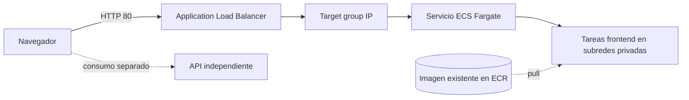

# Frontend on ECS Fargate

Terraform para publicar un frontend web en AWS ECS Fargate, detrás de un Application Load Balancer (ALB). La API es independiente y queda fuera de esta infraestructura.

## Alcance

- Crea un ALB público HTTP, un target group y su security group.
- Ejecuta el contenedor del frontend como servicio ECS Fargate en subredes privadas.
- Crea el rol de ejecución y configura escalado automático por utilización de CPU.
- No crea la VPC, las subredes, el repositorio ECR ni la imagen del contenedor.

## Arquitectura



## Prerrequisitos

- Cuenta AWS y credenciales disponibles mediante la cadena estándar del provider AWS.
- VPC existente con subredes públicas para el ALB y privadas para Fargate.
- Las tareas privadas necesitan salida a ECR para descargar la imagen, por ejemplo mediante NAT o los VPC endpoints correspondientes.
- Imagen del frontend publicada en ECR antes del despliegue. El contenedor debe escuchar en el puerto 80 y responder `200` en `/` para pasar el health check.
- El Dockerfile de referencia espera un proyecto Node.js que produzca `build/` y una configuración `nginx.conf` en el contexto de build.

## Implementación

Desde `terraform/`, definir las variables requeridas en un archivo local `terraform.tfvars`:

```hcl
region             = "us-east-1"
project_name       = "my-frontend"
environment        = "dev"
container_image    = "<account>.dkr.ecr.<region>.amazonaws.com/<repository>:<tag>"
vpc_id             = "vpc-..."
public_subnet_ids  = ["subnet-..."]
private_subnet_ids = ["subnet-...", "subnet-..."]
```

El archivo `terraform.tfvars` está excluido de Git. Publicar la imagen en ECR desde el repositorio del frontend y luego ejecutar:

```sh
terraform init
terraform plan
terraform apply
```

La URL resultante se muestra en el output `frontend_url`. Ajustar `desired_count`, `min_capacity` y `max_capacity` según el entorno cuando sea necesario.