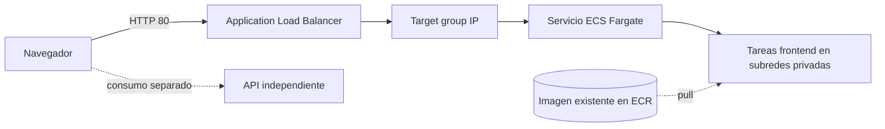

# Frontend on ECS Fargate

Terraform para publicar un frontend web en AWS ECS Fargate, detrás de un Application Load Balancer (ALB). La API es independiente y queda fuera de esta infraestructura.

## Alcance

- Crea un ALB público HTTP, un target group y su security group.
- Ejecuta el contenedor del frontend como servicio ECS Fargate en subredes privadas.
- Crea el rol de ejecución y configura escalado automático por utilización de CPU.
- No crea la VPC, las subredes, el repositorio ECR ni la imagen del contenedor.

## Arquitectura



## Prerrequisitos

- Cuenta AWS y credenciales disponibles mediante la cadena estándar del provider AWS.
- VPC existente con subredes públicas para el ALB y privadas para Fargate.
- Las tareas privadas necesitan salida a ECR para descargar la imagen, por ejemplo mediante NAT o los VPC endpoints correspondientes.
- Repositorio ECR existente y un agente Jenkins con Docker, AWS CLI, Terraform y acceso al socket de Docker.
- Un rol IAM asociado al agente Jenkins, con permisos limitados para publicar en ese repositorio ECR y administrar los recursos de este stack. Las tareas ECS necesitan permisos de lectura de ECR en su rol de ejecución.
- Un bucket S3 existente para el estado Terraform, con versionado y cifrado habilitados. El backend usa locking nativo de S3; el agente requiere permisos sobre el bucket y el objeto de estado.
- El agente Jenkins debe tener conectividad de red con AWS y poder acceder al endpoint del contenedor local para la prueba smoke.

## Implementación

El sitio estático está en `site/index.html` y el `Dockerfile` lo sirve directamente con Nginx. Jenkins valida cada rama y, solo para `main`, publica una imagen etiquetada con el commit y actualiza el servicio `dev` mediante Terraform.

Configurar el job como **Multibranch Pipeline** apuntando a este repositorio y permitir que Jenkins descubra el `Jenkinsfile`. El pipeline expone estos parámetros; los valores de subredes deben estar en formato JSON:

```text
AWS_REGION=us-east-1
AWS_ACCOUNT_ID=<cuenta AWS>
ECR_REPOSITORY=<repositorio existente>
TF_STATE_BUCKET=<bucket existente>
TF_STATE_KEY=aype-frontend/dev/terraform.tfstate
VPC_ID=vpc-...
PUBLIC_SUBNET_IDS=["subnet-...","subnet-..."]
PRIVATE_SUBNET_IDS=["subnet-...","subnet-..."]
```

Asociar los permisos AWS al agente mediante un rol IAM; no guardar access keys en el repositorio ni en el Jenkinsfile. Antes del primer despliegue, confirmar que el bucket de estado está creado y que la identidad Jenkins puede usarlo. Si ya se aplicó Terraform con estado local, migrarlo al backend S3 antes de habilitar el stage `Deploy dev`; no iniciar un estado remoto vacío sobre recursos ya administrados.

El stage de despliegue ejecuta `terraform plan` y `terraform apply` automáticamente al integrar en `main`, sin aprobación manual. Jenkins debe tener instalados los plugins Pipeline, Git y Branch API, y el webhook del proveedor Git debe notificar los cambios.

La URL resultante se muestra en el output `frontend_url`. Las fuentes, Tailwind CSS y algunas imágenes del sitio se cargan desde servicios externos (Google Fonts, Tailwind CDN y Unsplash), por lo que el navegador necesita conectividad a Internet para esos recursos.